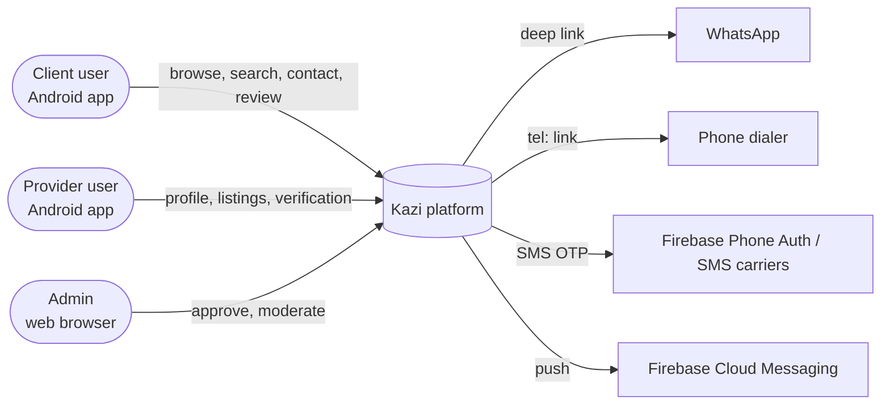
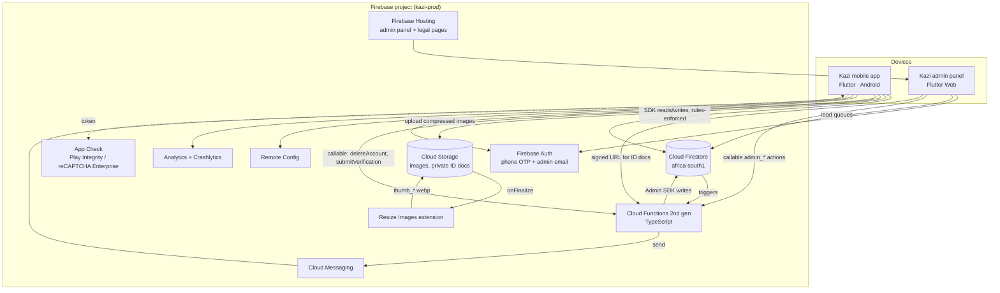
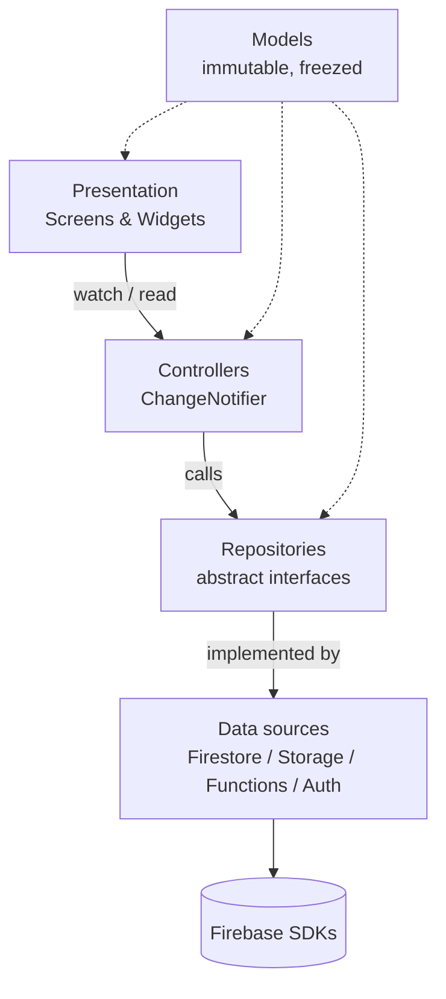
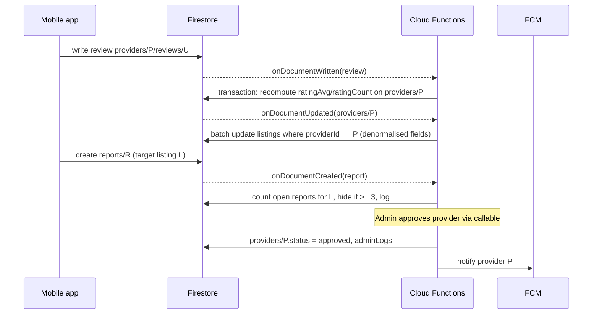

# Kazi — Architecture Design Document (ADD)

| | |
|---|---|
| **Version** | v1.0 |
| **Status** | Draft for build |
| **Last updated** | 2026-11-01 |
| **Related** | [PRD](01-PRD.md) · [TDD](03-TDD.md) · [Ops](09-DEVOPS-RELEASE.md) |

---

## 1. Purpose

This document describes the **high-level architecture** of Kazi v1: the system's building blocks, how they talk to each other, where data lives, how security works, and the key architectural decisions (ADRs). Implementation detail (schemas, rules, class names) lives in the [TDD](03-TDD.md).

## 2. Architectural drivers

| Driver | Source | Consequence |
|---|---|---|
| Solo developer + AI coding agents | Team | Managed backend (Firebase), single Flutter codebase, strict conventions |
| Free app, low budget | PRD §3 | Serverless pay-per-use; minimise reads; no always-on servers |
| Low-end devices, costly data | PRD §5 | Thin client, thumbnails, offline cache, bundled fonts |
| Trust and moderation | PRD §6.5 | Server-side moderation logic, audit logs, admin-only callables |
| Growth to new cities/languages/monetisation | PRD §12 | Multi-city data model, i18n from day 1, payment abstraction deferred but not blocked |
| Mandated stack | Owner | **Flutter + Firebase + Provider** |

## 3. System context

Kazi never relays messages or calls. It opens WhatsApp or the dialer on the client's own device.

## 4. Container view

### 4.1 Containers

| Container | Technology | Responsibility |
|---|---|---|
| **Mobile app** | Flutter (Dart 3), Provider, go_router | All client and provider features. Reads via Firestore SDK with offline cache; writes allowed by security rules |
| **Admin panel** | Flutter Web, same repo, separate entrypoint `lib/main_admin.dart` | Moderation queues, categories, audit log. Privileged writes only via callable Functions |
| **Firebase Auth** | Phone provider (users), Email/Password (admins) | Identity. Roles via **custom claims** (`admin`, `moderator`) |
| **Cloud Firestore** | Native mode, region `africa-south1` (Johannesburg) | Primary database. Offline persistence on mobile |
| **Cloud Storage** | Default bucket, same region | Profile, cover, listing and portfolio images (public read), ID documents (private, admin-only via signed URLs) |
| **Cloud Functions** | 2nd gen, TypeScript, Node 22, same region where supported | Derived data (ratings, denormalisation, search keywords), moderation, notifications, account deletion, admin actions |
| **Resize Images extension** | `storage-resize-images` | Generates `200x200` and `800x800` WebP versions of uploaded images |
| **FCM** | Firebase Cloud Messaging | Status notifications to providers |
| **Remote Config** | | Feature flags, minimum supported version, maintenance banner |
| **App Check** | Play Integrity (Android), reCAPTCHA Enterprise (web), debug provider (dev) | Blocks non-genuine clients from Firestore, Storage, Functions and Phone Auth abuse |
| **Analytics / Crashlytics** | | Product metrics, crash reporting |
| **Hosting** | Firebase Hosting | Admin panel, Terms/Privacy pages, share-link landing page |

## 5. Mobile app architecture

### 5.1 Layering (feature-first, MVVM with Provider)

| Layer | Contains | Rules |
|---|---|---|
| **Presentation** | Screens, widgets, `context.watch/select` | No Firebase imports. No business logic beyond formatting |
| **Controllers** | `ChangeNotifier` classes (e.g. `SearchResultsController`, `ListingFormController`) exposing immutable state + methods | Depend only on repository **interfaces**. No `BuildContext` stored |
| **Repositories** | Interfaces in `domain/`, Firebase implementations in `data/` | Map Firestore documents ⇄ models; translate exceptions to `AppException` |
| **Models** | `freezed` data classes + `json_serializable` | Pure Dart, no Flutter imports |

### 5.2 State management with Provider

- **App-scoped providers** (created once in `AppProviders`): Firebase instances, repositories (`Provider<…>`), `AuthController`, `SessionController` (current user and provider profile), `LocaleController`, `ConnectivityController`, `RemoteConfigController`.
- **Screen-scoped providers**: `ChangeNotifierProvider(create: …)` wrapping each route that needs a controller, so state is disposed when the route is popped.
- **Dependency wiring**: `ProxyProvider` / `ChangeNotifierProxyProvider` where a controller depends on the session (e.g. `FavoritesController` depends on `uid`).
- **Router integration**: `go_router` with `refreshListenable: authController` for redirects (guest → sign-in gate, admin guard on the web).
- **No other state libraries** (no Riverpod/Bloc/GetX). See ADR-003.

### 5.3 Navigation

`go_router` with a `StatefulShellRoute` for the five bottom-tab branches (Accueil, Explorer, Publier, Messages*, Profil). Deep links: `kazi://p/{providerId}` and `https://<domain>/p/{providerId}` (App Links).

\* In v1 the **Messages** tab shows a "Bientôt disponible / Coming soon" explainer and the list of recent contacts (from `contacts`), so the tab keeps its place in the design for v2 chat.

### 5.4 Offline and data efficiency

- Firestore persistence enabled with a 100 MB cache size.
- Queries paginated (`limit(20)` + `startAfterDocument`).
- Lists render **denormalised listing documents only** (no N+1 provider reads).
- `cached_network_image` with disk cache; lists use `thumb_200` and detail screens use `thumb_800`; the original is only shown when zooming.
- Fonts (Montserrat) **bundled as assets**, never fetched at runtime.
- Images compressed before upload (`flutter_image_compress`).

## 6. Backend architecture (Firebase)

### 6.1 Data ownership and write paths

| Data | Written by client (rules-validated) | Written only by Functions (Admin SDK) |
|---|---|---|
| `users/{uid}` basic profile | ✅ own doc, whitelisted fields | `status`, `deletedAt` |
| `providers/{uid}` | ✅ own profile fields | `status`, `verified`, `ratingAvg`, `ratingCount`, `listingCount`, stats |
| `listings/{id}` | ✅ own content fields, `status` ∈ {draft, paused, active} | `searchKeywords`, provider denormalised fields, `ratingAvg`, moderation status |
| `providers/{pid}/reviews/{uid}` | ✅ own review (contact must exist) | — |
| `contacts/{uid_pid}` | ✅ create/update own | — |
| `reports/{id}` | ✅ create only | status changes |
| `categories`, `config/*` | ❌ | admin callables / seed scripts |
| `adminLogs` | ❌ | ✅ |
| `verificationRequests` | ✅ create own (via callable) | decisions |

**Principle:** anything other users rely on for trust (ratings, verified badge, approval, counts) is **server-computed**. Clients can never set it.

### 6.2 Event-driven functions

### 6.3 Search strategy (v1)

Firestore has no full-text search. v1 uses:

1. **Structured filters**: `categoryId`, `city`, `commune`, `providerVerified`, `status == active`, ordered by `ratingAvg` or `publishedAt` (composite indexes).
2. **Keyword prefix search**: Functions compute `searchKeywords` (lower-case, accent-stripped tokens and their prefixes from title, category names FR/EN, provider name, commune; max ~150 entries) and the app queries `array-contains` on the normalised first token of the user's query, then filters further on the client.

When listings exceed ~20k or relevance becomes a problem, move to **Typesense or Algolia** through the Firebase extension (ADR-006). The repository interface (`SearchRepository`) isolates this change.

### 6.4 Media pipeline

1. App compresses the image (≤ 1280 px, JPEG ~75%) and uploads it to `listings/{listingId}/{imageId}.jpg` (path validated by Storage rules: owner, size ≤ 2 MB, `image/*`).
2. The Resize Images extension writes `…/thumbs/{imageId}_200x200.webp` and `_800x800.webp`.
3. The app stores `{path, url, thumbSmall, thumbLarge}` in the listing. Thumbnail URLs are derived deterministically; the UI falls back to the original while thumbs are generating.
4. When a listing or image is deleted, a Function deletes the orphaned Storage objects.

ID verification documents go to `private/verification/{uid}/…`. They are never publicly readable, viewed by admins via short-lived signed URLs from a callable, and deleted by the decision callable or by a scheduled cleanup after 30 days.

## 7. Security architecture

| Layer | Control |
|---|---|
| **Identity** | Phone OTP for users; email/password + custom claim for admins. Claims are set only via a CLI script/callable restricted to `superAdmin` |
| **Device integrity** | App Check enforced on Firestore, Storage, Functions; Play Integrity on Android; Phone Auth abuse protection via App Check / SMS region policy (allow `CD`, `ZA`, other selected regions) |
| **Data access** | Firestore and Storage rules, **deny by default**, field-level validation (types, lengths, enums, immutable fields), ownership checks, role checks via `request.auth.token.admin` |
| **Privileged operations** | Only via callable Functions that verify claims and write `adminLogs` |
| **PII minimisation** | Phone number stored once in `users` (private); providers choose which **WhatsApp/public phone** number to expose; ID documents ephemeral |
| **Abuse limits** | Max listings per provider (rules + function), max photos, max review length, report de-duplication (one report per user per target via deterministic ID) |
| **Secrets** | No secrets in the client. Functions use Secret Manager (`defineSecret`) if third-party keys are added |
| **Testing** | Rules unit tests with the Emulator Suite run in CI; a PR cannot merge if rules tests fail |

## 8. Deployment and environments

| Environment | Firebase project | Use | Flutter flavor / entry |
|---|---|---|---|
| **local** | Emulator Suite | Development, automated tests | `dev` + `USE_EMULATORS=true` |
| **dev** | `kazi-dev` | Internal testing, agent experiments | `dev` |
| **prod** | `kazi-prod` | Play Store + admin panel | `prod` |

- Both projects on the **Blaze plan** (Cloud Storage default buckets and Cloud Functions require it). The free usage tiers still apply; **budget alerts** are mandatory.
- Region: **`africa-south1`** for Firestore, Storage and Functions (closest Google region to the DRC). Confirm each product's availability in that region when creating the projects. If a product isn't available there, use `europe-west1` for Functions only. The Firestore location can't be changed after creation.
- CI/CD: GitHub Actions (details in [Ops](09-DEVOPS-RELEASE.md)).

## 9. Scalability and cost

| Concern | Approach |
|---|---|
| Read volume | Denormalised listing cards; paginate; cache; avoid listeners on lists (one-time `get()` with pull-to-refresh), real-time listeners only on own data |
| Hot documents | No global counters in a single doc; per-provider counters updated by Functions (low write rate) |
| Fan-out on provider update | Batch-update ≤ 10 listings per provider (capped by rules) |
| Function cold starts | `minInstances: 0` in v1 (cost). Consider `1` for callables used in the admin panel only if latency hurts |
| Growth beyond Kinshasa | `city` is part of every query; the composite indexes include it |

## 10. Architecture Decision Records (ADR)

### ADR-001 — Firebase as backend instead of custom ASP.NET Core API
- **Status:** Accepted
- **Context:** The earlier recommendation was ASP.NET Core + PostgreSQL/PostGIS. The owner chose Firebase to ship faster with agents and avoid running servers.
- **Decision:** Firebase (Auth, Firestore, Storage, Functions, FCM, Hosting).
- **Consequences:** Faster MVP, no ops. Weaker search and geo queries (mitigated by §6.3, ADR-006), vendor lock-in (mitigated by repository interfaces), cost tied to reads (mitigated by §9).

### ADR-002 — Flutter for mobile and admin web
- **Status:** Accepted
- **Decision:** One Flutter codebase: Android app (`lib/main.dart`) and admin web (`lib/main_admin.dart`), sharing models, repositories and theme.
- **Consequences:** Code reuse and one language for agents. Flutter Web bundle is heavy, but that's acceptable for an internal admin tool.

### ADR-003 — Provider for state management
- **Status:** Accepted
- **Decision:** `provider` package with `ChangeNotifier` controllers (MVVM). No Riverpod/Bloc/GetX.
- **Consequences:** Simple, well documented, easy for agents. Controllers must be kept small, and state must be exposed as immutable models, to avoid "god notifiers".

### ADR-004 — Contact via WhatsApp/phone instead of in-app chat in v1
- **Status:** Accepted
- **Decision:** Deep links only; record `contacts` for review gating and metrics.
- **Consequences:** No chat moderation burden, and it matches user habits. Kazi loses visibility into conversations. Chat is planned for v2.

### ADR-005 — Server-computed trust data
- **Status:** Accepted
- **Decision:** Ratings, verification, approval and counts are written only by Functions/Admin SDK.
- **Consequences:** Data can't be forged. Ratings update with eventual consistency (seconds).

### ADR-006 — Keyword-array search in v1, external search engine later
- **Status:** Accepted
- **Decision:** `searchKeywords` arrays + structured filters; migrate to Typesense/Algolia behind `SearchRepository` when needed.

### ADR-007 — Region `africa-south1`
- **Status:** Accepted (verify availability per product at setup)
- **Decision:** Host data in Johannesburg to minimise latency to Kinshasa.

### ADR-008 — Commune-based location instead of precise geolocation
- **Status:** Accepted
- **Decision:** Location is city + commune (+ optional quartier text). Optional device GPS is used only client-side for "near me" (v1.1, using a stored commune centroid or an optional provider GeoPoint/geohash).
- **Consequences:** Privacy-friendly and fits informal addresses. Distances are approximate.
